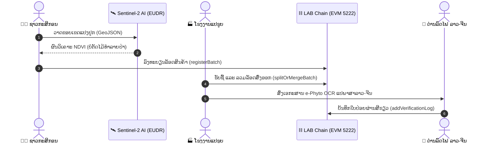

# 🇱🇦 ລະບົບຕິດຕາມ ແລະ ກວດສອບຍ້ອນກັບແຫ່ງຊາດ — ສປປ ລາວ
### Lao National Agricultural Traceability & EUDR Verification Platform

<p align="left">
  
  
  
  
  
  
</p>

ເວທີກວດສອບຍ້ອນກັບສິນຄ້າກະສິກຳແຫ່ງຊາດ ບົນເຄືອຂ່າຍບລັອກເຊນ **LAB Chain (Chain ID: 5222)** ຮອງຮັບມາດຕະຖານການຄ້າສາກົນ ແລະ ກົດລະບຽບການບໍ່ຕັດໄມ້ທຳລາຍປ່າຂອງສະຫະພາບເອີຣົບ (EUDR).

---


## 📡 Go Backend API (Port 4001) Integration
* **Base URL:** `http://localhost:4001/api/v1`
* **Register Batch Endpoint:** `POST /batch/register` (ສະແດງຜົນທີ່ `/#/register` ພ້ອມສ້າງ QR Code ທັນທີ)
* **Tracking & AI Logs Endpoint:** `GET /batch/:id` (ສະແດງຜົນທີ່ `/#/track/:batch_id` ແຍກສະຖານະ EUDR ແລະ ແປພາສາຈີນ GACC)

---

## 🌟 3 ລະບົບຫຼັກທີ່ເຊື່ອມໂຍງກັນ (3 Core Portals)

### 1. 👨‍🌾 ລະບົບຊາວກະສິກອນ & ພໍ່ຄ້າຄົນກາງ (Farmer & Middleman App)
* **ຮອງຮັບ PWA ມືຖື:** ໜ້າຕາອອກແບບໃຫ້ໃຊ້ງານງ່າຍ ພ້ອມປຸ່ມສຳລັບຜູ້ສູງອາຍຸ
* **GIS Satellite Land Mapping:** ລະບົບແຜນທີ່ດາວທຽມວາດຂອບເຂດແປງປູກ (GeoJSON Coordinates)
* **Autonomous EUDR Check:** ວິເຄາະພາບຖ່າຍດາວທຽມ Sentinel-2 (NDVI Score) ກວດສອບພື້ນທີ່ບໍ່ມີການຕັດໄມ້ທຳລາຍປ່າຫຼັງປີ 2020
* **Batch QR Code:** ສ້າງລະຫັດ QR Code ປະຈຳລັອດສິນຄ້າພ້ອມລະຫັດ Hash ບົນບລັອກເຊນ

### 2. 🏭 ລະບົບໂຮງງານແປຮູບ & ສົ່ງອອກ (Factory & Exporter Portal)
* **Stock & Processing Dashboard:** ຕິດຕາມວັດຖຸດິບທີ່ຮັບຊື້ເຂົ້າມາຈາກຊາວກະສິກອນ
* **Smart Batch Management:** ລະບົບລວມຫຼາຍລັອດຍ່ອຍ (Multi-farm Merge) ໃຫ້ເປັນຊຸດສົ່ງອອກຂະໜາດໃຫຍ່
* **AI e-Phyto OCR:** ສະແກນໃບຢັ້ງຢືນສຸຂານາໄມພືດ ແລະ ແປພາສາລາວ-ຈີນອັດຕະໂນມັດ ຮອງຮັບດ່ານສາກົນ GACC

### 3. 🛃 ລະບົບດ່ານສາກົນ & ຄວາມໂປ່ງໃສ (Customs & Cross-Border SSOT)
* **Single Source of Truth (SSOT):** ກວດສອບຂໍ້ມູນສິນຄ້າທັງໝົດໄດ້ໃນໜ້າດຽວ ບໍ່ສາມາດປອມແປງໄດ້
* **Immutable Audit Trail:** ເສັ້ນທາງການເດີນທາງຂອງສິນຄ້າຕັ້ງແຕ່ແປງປູກ, ໂຮງງານ, ຈົນຮອດດ່ານລົດໄຟ
* **Green Channel Release:** ລະບົບອະນຸມັດປ່ອຍຜ່ານດ່ານຂົນສົ່ງທາງລົດໄຟ ລາວ-ຈີນ (Lao-China Railway) ຢ່າງວ່ອງໄວ

---

## 🔄 ຂັ້ນຕອນການກວດສອບຍ້ອນກັບ 5 ໄລຍະ (5-Stage Verification Pipeline)



### 🚂 ການເຊື່ອມໂຍງດ່ານລົດໄຟ ລາວ-ຈີນ (Lao-China Railway Green Channel)
* **ຈຸດເຊື່ອມຕໍ່:** ສະຖານີວຽງຈັນໃຕ້ (Vientiane South) / ທ່າບົກທ່ານາແລ້ງ (Thanaleng Dry Port) ➡️ ດ່ານບໍ່ເຕັນ-ໂມ່ຫານ (Boten-Mohan Rail Port)
* **ກວດສອບໄວ:** ພຽງແຕ່ສະແກນ QR Code ປະຈຳຕູ້ຄອນເທນເນີ ລະບົບຈະດຶງຂໍ້ມູນ Single Source of Truth (SSOT) ຈາກ Smart Contract ທັນທີ ຫຼຸດເວລາຜ່ານດ່ານຈາກ 48 ຊົ່ວໂມງ ເຫຼືອພຽງບໍ່ຮອດ 15 ນາທີ.

---

## 🛠️ ເທັກໂນໂລຊີທີ່ນຳໃຊ້ (Tech Stack)

* **Frontend:** React 19, TypeScript, Vite
* **Styling & Fonts:** CSS Variables (Organic Sage Palette), Noto Sans Lao Looped & Phetsarath Typography
* **Maps & GIS:** Leaflet, OpenStreetMap, ESRI World Imagery
* **Web3 & Blockchain:** Ethers.js v6, LAB Chain (Consortium EVM)
* **Storage Proof:** IPFS (InterPlanetary File System)

---

## 🚀 ວິທີຕິດຕັ້ງ ແລະ ເປີດໃຊ້ງານ (Getting Started)

### 1. Clone Repository
```bash
git clone https://github.com/tavanhvannala677-beep/my-new-web3.git
cd my-new-web3
```

### 2. ເຂົ້າສູ່ໂຟລເດີ DApp ແລະ ຕິດຕັ້ງ Dependencies
```bash
cd dapp
npm install
```

### 3. ເປີດລະບົບ Local Dev Server
```bash
npm run dev
```
ເປີດບຣາວເຊີໄປທີ່: `http://localhost:5175`

### 4. ທົດສອບ ແລະ ກວດສອບຄຸນນະພາບໂຄ້ດ (Testing & Quality Assurance)
```bash
# Run unit tests (Vitest)
npm test

# Type-check TypeScript without building
npm run typecheck

# Build for Production
npm run build
```

---

## ⚙️ ການຕັ້ງຄ່າ Environment Variables (`.env`)

ສ້າງໄຟລ໌ `.env` ໃນໂຟລເດີ `dapp/` ໂດຍອ້າງອີງຈາກ `.env.example`:

| Variable | Default Value | Description |
|---|---|---|
| `VITE_CONTRACT_ADDRESS` | `0xee891fb89...` | ທີ່ຢູ່ Smart Contract ບົນ LAB Chain |
| `VITE_CHAIN_ID` | `5222` | EVM Chain ID ຂອງ LAB Chain |
| `VITE_RPC_URL` | `https://rpc.labchain.la` | RPC Endpoint ສຳລັບເຊື່ອມຕໍ່ບລັອກເຊນ |
| `VITE_PYTHON_AI_URL` | `http://localhost:5000` | Microservice ວິເຄາະດາວທຽມ EUDR & OCR ແປພາສາ |
| `VITE_BACKEND_API_URL` | `http://localhost:4001/api/v1` | Go Backend REST API |

---

## 🌐 ສະຖາປັດຕະຍະກຳ Microservices (Service Endpoints Matrix)

| Service | Port / Protocol | ເປົ້າໝາຍການນຳໃຊ້ (Responsibility) |
|---|---|---|
| **Frontend DApp** | `http://localhost:5175` | React 19 SPA (Farmer, Factory, Customs Portals) |
| **Go Backend API** | `http://localhost:4001` | Batch indexing, local storage, audit log caching |
| **Python AI Engine** | `http://localhost:5000` | Sentinel-2 NDVI canopy score & e-Phyto OCR |
| **LAB Chain RPC** | `https://rpc.labchain.la` | Consortium EVM Proof of Authority (PoA) |

---

## ⛓️ ຂໍ້ມູນເຄືອຂ່າຍ LAB Chain

| ລາຍການ | ຄ່າການເຊື່ອມຕໍ່ |
|---|---|
| **Network Name** | LAB Chain |
| **Chain ID** | `5222` |
| **RPC URL** | `https://rpc.labchain.la` |
| **Currency** | `LAB` |
| **Block Explorer** | https://explorer.labchain.la |

---

## 🩺 ການກວດສອບສະຖານະເຄືອຂ່າຍ & ການແກ້ໄຂບັນຫາ (Diagnostics & Troubleshooting)

ລະບົບມີຕົວກວດສອບສະຖານະການເຊື່ອມຕໍ່ RPC ແລະ ການແປຂໍ້ຜິດພາດເປັນພາສາລາວອັດຕະໂນມັດ:

### 1. ຕາຕະລາງການຈັດໝວດໝູ່ Error Codes

| ປະເພດ (Category) | ລະຫັດ Error / ສາເຫດ | ຄຳອະທິບາຍ (Lao & English) | ວິທີແກ້ໄຂ (Remediation) |
|---|---|---|---|
| `USER_REJECTED` | `4001`, `ACTION_REJECTED` | ຜູ້ໃຊ້ຍົກເລີກການຢືນຢັນໃນ MetaMask | ກວດສອບລາຍລະອຽດແລ້ວກົດ Confirm ໃນກະເປົາເງິນອີກຄັ້ງ |
| `INSUFFICIENT_FUNDS` | `INSUFFICIENT_FUNDS` | ຍອດເງິນ LAB ບໍ່ພຽງພໍຄ່າ Gas | ຮັບຫຼຽນ LAB ສຳລັບທົດສອບ ຫຼື ເຕີມແກັສເຂົ້າ Wallet |
| `NETWORK_ERROR` | `TIMEOUT`, `Failed to fetch` | ບໍ່ສາມາດເຊື່ອມຕໍ່ RPC Endpoint ໄດ້ | ກວດສອບອິນເຕີເນັດ ຫຼື ລອງປ່ຽນ RPC URL ໃນ `.env` |
| `CONTRACT_REVERT` | `CALL_EXCEPTION` | Smart Contract ປະຕິເສດເງື່ອນໄຂ | ກວດສອບສິດທິຜູ້ບັນທຶກ (Owner/Operator) ແລະ ຮູບແບບ Batch ID |
| `NONCE_EXPIRED` | `NONCE_EXPIRED` | ເລກທຸລະກຳຊໍ້າຊ້ອນ | ລໍຖ້າທຸລະກຳກ່ອນໜ້າສຳເລັດ ຫຼື Reset Account ໃນ MetaMask |

### 2. ຕົວຊີ້ວັດຄວາມໄວເຄືອຂ່າຍ (RPC Latency Benchmarks)

* 🟢 **Optimal (<300ms):** ເຄືອຂ່າຍເຮັດວຽກປົກກະຕິ ພ້ອມບັນທຶກທຸລະກຳໄວ
* 🟡 **Degraded (>300ms):** ສັນຍານອິນເຕີເນັດຊ້າ ຫຼື RPC ມີຄົນໃຊ້ງານຫຼາຍ
* 🔴 **Offline:** ບໍ່ສາມາດຕິດຕໍ່ RPC Node ໄດ້ ລະບົບຈະສະຫຼັບໃຊ້ Mock Data ຊົ່ວຄາວ

---

## 📄 License
MIT License
