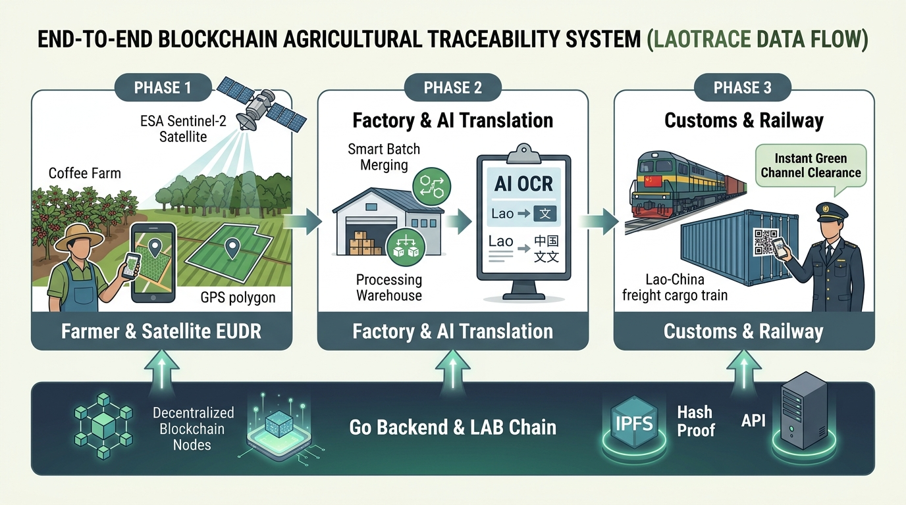

# 🇱🇦 ລະບົບຕິດຕາມ ແລະ ກວດສອບຍ້ອນກັບແຫ່ງຊາດ — ສປປ ລາວ
### Lao National Agricultural Traceability & EUDR Verification Platform

<p align="left">
  
  
  
  
  
  
</p>

ເວທີກວດສອບຍ້ອນກັບສິນຄ້າກະສິກຳແຫ່ງຊາດ ບົນເຄືອຂ່າຍບລັອກເຊນ **LAB Chain (Chain ID: 5222)** ຮອງຮັບມາດຕະຖານການຄ້າສາກົນ ແລະ ກົດລະບຽບການບໍ່ຕັດໄມ້ທຳລາຍປ່າຂອງສະຫະພາບເອີຣົບ (EUDR).

---



## 📡 Go Backend API (Port 4001) Integration
* **Base URL:** `http://localhost:4001/api/v1`
* **Register Batch Endpoint:** `POST /batch/register` (ສະແດງຜົນທີ່ `/#/register` ພ້ອມສ້າງ QR Code ທັນທີ)
* **Tracking & AI Logs Endpoint:** `GET /batch/:id` (ສະແດງຜົນທີ່ `/#/track/:batch_id` ແຍກສະຖານະ EUDR ແລະ ແປພາສາຈີນ GACC)

---

## 🌟 3 ລະບົບຫຼັກທີ່ເຊື່ອມໂຍງກັນ (3 Core Portals)

### 1. 👨‍🌾 ລະບົບຊາວກະສິກອນ & ພໍ່ຄ້າຄົນກາງ (Farmer & Middleman App)
* **ຮອງຮັບ PWA ມືຖື:** ໜ້າຕາອອກແບບໃຫ້ໃຊ້ງານງ່າຍ ພ້ອມປຸ່ມສຳລັບຜູ້ສູງອາຍຸ
* **GIS Satellite Land Mapping:** ລະບົບແຜນທີ່ດາວທຽມວາດຂອບເຂດແປງປູກ (GeoJSON Coordinates)
* **Autonomous EUDR Check:** ວິເຄາະພາບຖ່າຍດາວທຽມ Sentinel-2 (NDVI Score) ກວດສອບພື້ນທີ່ບໍ່ມີການຕັດໄມ້ທຳລາຍປ່າຫຼັງປີ 2020
* **Batch QR Code:** ສ້າງລະຫັດ QR Code ປະຈຳລັອດສິນຄ້າພ້ອມລະຫັດ Hash ບົນບລັອກເຊນ

### 2. 🏭 ລະບົບໂຮງງານແປຮູບ & ສົ່ງອອກ (Factory & Exporter Portal)
* **Stock & Processing Dashboard:** ຕິດຕາມວັດຖຸດິບທີ່ຮັບຊື້ເຂົ້າມາຈາກຊາວກະສິກອນ
* **Smart Batch Management:** ລະບົບລວມຫຼາຍລັອດຍ່ອຍ (Multi-farm Merge) ໃຫ້ເປັນຊຸດສົ່ງອອກຂະໜາດໃຫຍ່
* **AI e-Phyto OCR:** ສະແກນໃບຢັ້ງຢືນສຸຂານາໄມພືດ ແລະ ແປພາສາລາວ-ຈີນອັດຕະໂນມັດ ຮອງຮັບດ່ານສາກົນ GACC

### 3. 🛃 ລະບົບດ່ານສາກົນ & ຄວາມໂປ່ງໃສ (Customs & Cross-Border SSOT)
* **Single Source of Truth (SSOT):** ກວດສອບຂໍ້ມູນສິນຄ້າທັງໝົດໄດ້ໃນໜ້າດຽວ ບໍ່ສາມາດປອມແປງໄດ້
* **Immutable Audit Trail:** ເສັ້ນທາງການເດີນທາງຂອງສິນຄ້າຕັ້ງແຕ່ແປງປູກ, ໂຮງງານ, ຈົນຮອດດ່ານລົດໄຟ
* **Green Channel Release:** ລະບົບອະນຸມັດປ່ອຍຜ່ານດ່ານຂົນສົ່ງທາງລົດໄຟ ລາວ-ຈີນ (Lao-China Railway) ຢ່າງວ່ອງໄວ

---

## 🛠️ ເທັກໂນໂລຊີທີ່ນຳໃຊ້ (Tech Stack)

* **Frontend:** React 19, TypeScript, Vite
* **Styling & Fonts:** CSS Variables (Organic Sage Palette), Noto Sans Lao Looped & Phetsarath Typography
* **Maps & GIS:** Leaflet, OpenStreetMap, ESRI World Imagery
* **Web3 & Blockchain:** Ethers.js v6, LAB Chain (Consortium EVM)
* **Storage Proof:** IPFS (InterPlanetary File System)

---

## 🚀 ວິທີຕິດຕັ້ງ ແລະ ເປີດໃຊ້ງານ (Getting Started)

### 1. Clone Repository
```bash
git clone https://github.com/tavanhvannala677-beep/my-new-web3.git
cd my-new-web3
```

### 2. ເຂົ້າສູ່ໂຟລເດີ DApp ແລະ ຕິດຕັ້ງ Dependencies
```bash
cd dapp
npm install
```

### 3. ເປີດລະບົບ Local Dev Server
```bash
npm run dev
```
ເປີດບຣາວເຊີໄປທີ່: `http://localhost:5175`

### 4. Build ສຳລັບ Production
```bash
npm run build
```

---

## ⛓️ ຂໍ້ມູນເຄືອຂ່າຍ LAB Chain

| ລາຍການ | ຄ່າການເຊື່ອມຕໍ່ |
|---|---|
| **Network Name** | LAB Chain |
| **Chain ID** | `5222` |
| **RPC URL** | `https://rpc.labchain.la` |
| **Currency** | `LAB` |
| **Block Explorer** | https://explorer.labchain.la |

---

## 📄 License
MIT License
